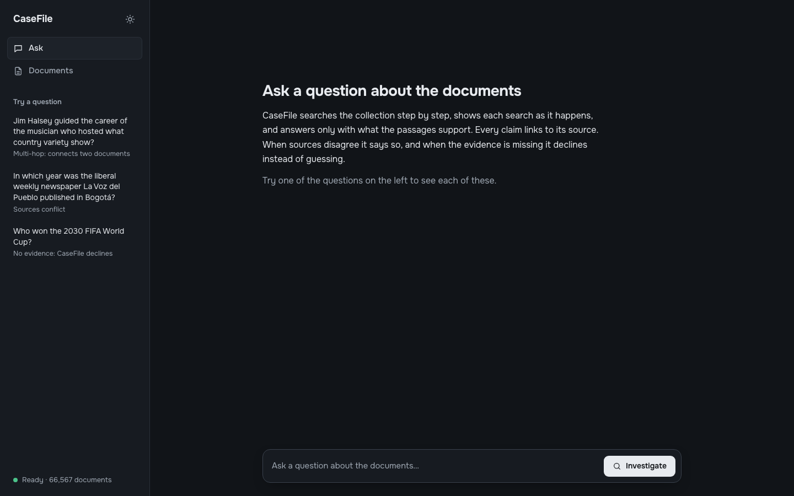

# CaseFile

**An AI investigation engine that cites its evidence.** Ask a question about a large document collection; CaseFile
searches step by step, follows facts from one document to the next, answers only with what the passages support, links
every claim to its source, reports when sources disagree, and declines when the evidence is missing.

**Live demo:** https://casefile.metroz.me (free hosting: after 15 idle minutes the first request takes about a minute
while the server wakes up)



| Document | What's in it |
|---|---|
| [`docs/EVALUATION.md`](docs/EVALUATION.md) | Evaluation report: 60 questions, retrieval and answer metrics, configurations compared, error analysis |
| [`docs/AI_USAGE.md`](docs/AI_USAGE.md) | AI usage report: tools, what AI wrote, what I did and changed myself |
| [`docs/DEPLOYMENT.md`](docs/DEPLOYMENT.md) | Deployment: architecture, secrets, persistence, memory and speed measurements |
| [`plan.md`](plan.md) | Plan, decisions and the requirements checklist |

## 1. What it does
- **Ingestion:** PDF, TXT/Markdown, HTML, JSON/JSONL and CSV; text and metadata extraction; two chunking strategies
  (fixed-size and sentence-based, compared in the evaluation); exact and near-duplicate detection (MinHash + LSH);
  add, update (same name, new content) and delete.
- **Search:** dense embeddings for meaning plus BM25 for exact words, merged with Reciprocal Rank Fusion. BM25, RRF and
  an optional reranker (query coverage + MMR diversity) are my own code.
- **Investigation agent:** an LLM with two tools (`search_documents`, `read_document`) in a loop of up to 5 steps. It
  searches, reads what it found, searches again for entities the first results revealed (multi-hop), then answers as
  JSON with chunk-level citations.
- **Trust checks:** every citation is validated against the passages the agent actually retrieved; conflicting sources
  are reported, citing both sides; with no supporting evidence the agent abstains instead of guessing; text inside
  documents is treated as data, not instructions (prompt-injection tests).
- **Reliability:** retries with exponential backoff and jitter, the provider's retry-after hints, a request rate limiter,
  timeouts, and an automatic **failsafe**: when Gemini fails, Groq answers and the answer says so.
- **UI:** live investigation log (streamed with Server-Sent Events), cited answer with a source drawer, conflict and
  "declined" states, a Stop button, a document manager with content search, upload, replace and delete, light and dark.
- **Scale:** the 66,555-paragraph HotpotQA dev corpus (78,730 chunks) indexed in Qdrant Cloud.

## 2. Architecture
```
Browser (React UI)
      │  HTTPS: /documents · /ask · /ask/stream (SSE) · /sources · /health
      ▼
FastAPI on Render (Docker, Frankfurt): one service that also serves the built UI at "/"
  ├─ ingestion: loaders → chunking → duplicate check (SHA-256 + MinHash/LSH) → embed + BM25 → store
  ├─ investigation agent (rag/agent.py), up to 5 tool steps:
  │     LLM (Gemini; Groq failsafe) ──tool call──► search_documents / read_document
  │      ▲                                             │ hybrid search: dense + BM25 → RRF (→ optional rerank)
  │      └─────────────── tool results ────────────────┘
  │     → JSON answer with chunk citations → citation validator → conflicts / abstention
  └─ protection: request rate limiter · per-visitor question limit · read-only corpus
      │
      ▼
Qdrant Cloud (Frankfurt): chunks (dense + sparse vectors, fingerprints) + documents
```

**One question, step by step:**
1. The browser posts the question to `/ask/stream` and reads the event stream with `fetch` (the browser's
   `EventSource` only supports GET).
2. The agent asks the LLM what to do. The LLM calls `search_documents("Kiss and Tell Corliss Archer")`.
3. Hybrid search embeds the query, runs a dense search and a BM25 search in Qdrant, fuses the two rankings with RRF
   and returns the top passages, each with its `chunk_id`. The UI shows the step live.
4. The results name a new entity (Shirley Temple), so the LLM searches again for her.
5. The LLM answers as JSON: the answer, one claim per fact with its `chunk_id` citations, conflicts, or an abstention.
6. The citation validator removes any citation to a passage the agent never retrieved, and the answer is streamed to
   the UI, where each citation opens its source passage.

**Repository layout**
```
backend/casefile/
  ingestion/   loaders.py · chunking.py · dedup.py (MinHash/LSH) · qdrant_dedup.py · pipeline.py (add/update/delete)
  retrieval/   embeddings.py · bm25.py · fusion.py (RRF) · rerank.py · search.py · store.py (Qdrant) · document_search.py
  rag/         agent.py · tools.py · prompts.py · citations.py · llm.py (Gemini, Groq, failsafe) · retry.py · llm_cache.py
  api/         app.py (FastAPI) · streaming.py (SSE) · services.py · visitor_limit.py
  evaluation/  eval_set.py · metrics.py · answer_eval.py (baseline + LLM judge)
  datasets/    hotpotqa.py
backend/tests/ 243 tests (no network, no keys: in-memory Qdrant, fake embedder, scripted fake LLM)
frontend/src/  React + TypeScript (Vite): App, investigation stream and state, components; 9 Vitest tests
eval/          dataset builder, indexer, evaluation runners, question sets, results, LLM reply cache
docs/          evaluation, AI usage, deployment reports
```

## 3. Running it
**Requirements:** Python 3.11, Node 24 (for the UI), a Gemini API key (free, Google AI Studio), optionally a Groq key
(free) and a Qdrant Cloud cluster (free). Without `QDRANT_URL`, an in-memory Qdrant is used.

```bash
# 1. Backend
python3.11 -m venv .venv
.venv/bin/pip install -r backend/requirements-dev.txt
cp .env.example .env            # then fill in the keys (never commit .env; it is git-ignored)

# 2. Data: download HotpotQA dev (distractor) and index it (about 1 hour on a laptop for 66k paragraphs)
.venv/bin/python eval/build_dataset.py
.venv/bin/python eval/index_corpus.py --in-memory --limit 2000   # quick try, nothing is saved
EMBEDDING_THREADS=0 .venv/bin/python eval/index_corpus.py        # the real run into Qdrant Cloud, all CPU cores

# 3. UI
cd frontend && npm ci && npm run build && cd ..

# 4. Server (serves the API and the built UI)
cd backend && ../.venv/bin/uvicorn casefile.api.app:app --port 8000      # open http://localhost:8000
```

**Tests:** `cd backend && ../.venv/bin/python -m pytest -q` (243) and `cd frontend && npm test` (9).

**Ask from the terminal:** `.venv/bin/python eval/ask.py "What government position was held by the woman who
portrayed Corliss Archer in the film Kiss and Tell?"`

**Docker (as deployed):**
```bash
docker build -t casefile .
docker run --rm -p 8000:8000 --env-file .env -m 512m casefile
```

**Evaluation:** see section 7 of [`docs/EVALUATION.md`](docs/EVALUATION.md). LLM replies are cached in
`eval/cache/llm`, so re-running an unchanged evaluation replays them without an API key.

## 4. Technical choices and why
| Area | Choice | Why |
|---|---|---|
| Backend | Python, FastAPI | Required Python; small, typed, built-in validation and docs; streaming responses |
| Vector DB | Qdrant (Cloud free tier) | Dense **and** sparse vectors in one collection, so hybrid search is one database; payload filters for duplicate lookups; data outside the app server, so restarts lose nothing |
| Embeddings | `bge-small-en-v1.5` via fastembed (local, quantized ONNX, 65 MB) | No API calls or quota for 78k chunks; small enough for a 512 MB server; strong for its size |
| Keyword search | Own BM25 encoder, Qdrant applies IDF | Catches exact names, ids and years that embeddings blur; my own algorithm (assignment requirement) |
| Fusion | Reciprocal Rank Fusion (k = 60) | Dense and BM25 scores are on different scales; ranks are comparable. Simple and robust |
| Reranker | Query coverage + MMR, optional | Built and tuned on dev; it didn't beat plain hybrid (one question either way), so `hybrid` is the default |
| Chunking | Sentence-based, 800 characters, 100 overlap | Compared with fixed-size at 800 and 300: no meaningful difference on HotpotQA (short paragraphs); sentences keep claims whole |
| Duplicates | SHA-256 (exact) + MinHash/LSH (near, Jaccard ≥ 0.85), fingerprints stored in Qdrant | Near-duplicates are common in real collections; storing fingerprints in Qdrant cut startup from 77.7 s to 0.9 s and memory from 938 to 372 MB |
| Dataset | HotpotQA dev, distractor setting | 66k real paragraphs (over the 50k requirement) with gold answers and supporting paragraphs, so retrieval and answers can be measured |
| LLM | `gemini-3.5-flash-lite`, temperature 0, own tool loop | Free tier; fast (larger models were overloaded); an own loop gives control over steps, logging the evidence, and the step limit |
| Failsafe | Groq `openai/gpt-oss-120b` behind the same interface | When Gemini's daily quota or service fails, the app keeps answering, and the answer says which model wrote it |
| Agent | Tool-calling loop instead of one retrieval | Multi-hop questions need a second search for an entity the first search reveals; the evaluation measures the gain |
| Streaming | Server-Sent Events | One-way progress events over plain HTTP; works through proxies with keep-alive comments |
| UI | React + TypeScript (Vite), no other runtime libraries | Typed contract with the API; FastAPI serves the built files, so one service and one URL |
| Hosting | Docker on Render (free, Frankfurt) + Cloudflare DNS | Free public URL with HTTPS and a custom domain; same region as Qdrant |

## 5. Results (test split; details in [`docs/EVALUATION.md`](docs/EVALUATION.md))
| Metric | Agent | One-search baseline |
|---|---|---|
| Answer accuracy (LLM judge; agreed 17/17 with a review of its verdicts by Claude Code, not a person) | **0.85** | 0.75 |
| Bridge (multi-hop) accuracy | **0.80** | 0.60 |
| False abstentions | **0.05** | 0.20 |
| Abstention on unanswerable questions | 1.00 | 1.00 |
| Conflict detection (planted contradictions) | 1.00 | 1.00 |
| Citation precision / recall | 0.92 / 0.92 | 1.00 / 0.97 |

Retrieval (test): hybrid finds every supporting paragraph in the top 5 for 0.80 of the questions vs 0.70 for dense
search only. The error analysis covers where it still fails (bridge hops it never discovers, comparison reasoning) and
how to improve it.

## 6. Performance and LLM cost
- **LLM calls:** about 2.9 per question (search steps + the answer); the one-search baseline uses 1. Gemini's free
  tier allows about 500 requests a day, so roughly 170 questions a day.
- **Protecting the quota:** a rate limiter keeps under 15 requests/minute; retries follow the provider's retry-after;
  a daily quota fails at once instead of retrying for minutes; the Groq failsafe takes over; each visitor of the public
  demo may ask 10 questions an hour; the Stop button ends an investigation before its next LLM call; the evaluation
  caches every LLM reply on disk (re-runs cost nothing).
- **Memory (512 MB server):** measured in the real image under a 512 MB limit: 108 MB at start, **404 MB** in the worst
  case (a question during a 1 MB upload). A 1 MB upload first needed 1.1 GB; embedding 4 chunks at a time instead of
  64 fixed it (`docs/DEPLOYMENT.md` section 7).
- **Speed:** a question takes about 3–30 s, mostly LLM time; a search step takes about 1 s; document search 0.5 s.
  Uploads embed on the free tier's fraction of a CPU, about 0.9 s per chunk (one ONNX thread is 4–9× faster there
  than the default thread count).

## 7. Security
- Secrets only in environment variables (`.env` locally, Render's dashboard in production); `.env` is git-ignored and
  excluded from the image; the git history was scanned for the real key values before publishing.
- The demo corpus is read-only through the API (an upload that reuses a corpus file name can't overwrite evidence);
  uploads are limited to 10 MB; the container runs as a non-root user.
- Prompt injection: documents are data, not instructions; tested with direct and disguised attack documents.

## 8. Limitations
- The corpus is HotpotQA's paragraphs, not all of Wikipedia: questions about anything else are (correctly) declined.
- Open questions ("what has X won?") are declined when the evidence is partial, because the answer rules were built
  for short, single-answer questions (`docs/EVALUATION.md` 6.10).
- English only: the BM25 tokenizer drops non-Latin letters and the embedding model is English.
- Free tiers: the server sleeps when idle; Gemini can be slow or out of quota (the Groq failsafe is slower).
- 60 evaluation questions: one question moves a metric by 0.05, so small differences are noise.

## 9. AI usage
Built with Claude Code as a pair programmer. What it wrote, what I decided, wrote, measured and changed myself, and
what I asked it to do for me is logged milestone by milestone in [`docs/AI_USAGE.md`](docs/AI_USAGE.md).

## 10. Author and license
CaseFile is made by **Zuka Metreveli** ([`AUTHORS.md`](AUTHORS.md)).
Copyright © 2026 Zuka Metreveli. Released under the MIT License ([`LICENSE`](LICENSE)).
